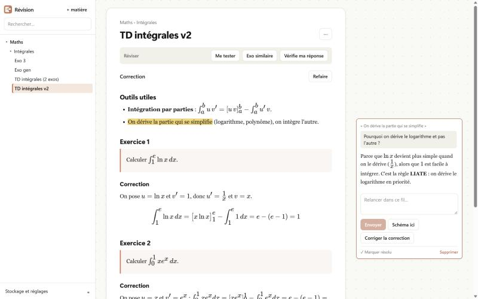

# Révision

App locale de révision avec Claude. Tu demandes la correction d'un exercice (photo, PDF, Word ou texte), puis tu sélectionnes n'importe quel passage pour poser une question dessus : la réponse s'affiche **en commentaire dans la marge**, au lieu d'un long fil de discussion à remonter.



- Correction rangée exercice par exercice : outils utiles, puis chaque énoncé suivi de sa correction.
- Commentaires surlignés en jaune, rouvrables d'un clic, avec schémas (organigrammes, courbes de fonctions, figures).
- Correction modifiable passage par passage, avec historique des versions.
- Révision : « Me tester » masque les corrections (sans appel à Claude), « Exo similaire », « Vérifie ma réponse ».
- Tout reste sur ton ordinateur (base SQLite locale). Claude n'est appelé que quand tu cliques sur un bouton.

*Interface en français.*

## Installation (Windows)

### 1. Ce qu'il faut installer d'abord

| Outil | Où le trouver | Pour quoi faire |
|---|---|---|
| **Node.js** (version « LTS », 22.13 ou plus) | [nodejs.org](https://nodejs.org) | faire tourner l'app |
| **Git** | [git-scm.com](https://git-scm.com) | télécharger l'app et ses mises à jour |
| **Un accès à Claude** (au choix, voir ci-dessous) | | les corrections et les réponses |

**Accès à Claude, deux possibilités :**

- **A. Claude Code avec ton abonnement Claude (Pro ou Max)** : rien à payer en plus. Installe Claude Code dans PowerShell, puis lance `claude` une fois pour te connecter :
  ```powershell
  irm https://claude.ai/install.ps1 | iex
  ```
  Chacun utilise **son propre** compte : ne partage pas le tien.
- **B. Une clé API Anthropic** : payée à l'usage. Crée une clé sur [console.anthropic.com](https://console.anthropic.com), puis colle-la dans l'app (« Stockage et réglages » › « Clé API Anthropic »). Pas besoin de Claude Code.

### 2. Télécharger l'app

Dans PowerShell :

```powershell
cd $HOME\Documents
git clone https://github.com/olodiont/revision-app.git
```

### 3. Lancer

Double-clique sur **`revision-app\scripts\lancer-revision.cmd`**.

- La première fois, il installe ce qu'il faut (une à deux minutes).
- L'app s'ouvre ensuite dans ton navigateur, à l'adresse `http://127.0.0.1:5317`.
- Une petite fenêtre de console reste ouverte : c'est le serveur de l'app. **Fermer l'onglet de l'app ferme la console** (au bout de quelques secondes), et fermer la console arrête l'app.

Pour un raccourci sur le Bureau : clic droit sur `lancer-revision.cmd` › *Envoyer vers* › *Bureau (créer un raccourci)*. Tu peux lui donner l'icône `public\icon.ico` (clic droit sur le raccourci › *Propriétés* › *Changer d'icône*).

### 4. Premiers pas

1. Dans le menu de gauche : « + matière », puis « ⋯ » › « + chapitre ».
2. Sur le chapitre : « + exo ». Colle l'énoncé ou ajoute une photo, un PDF ou un Word.
3. « Générer la correction ».
4. Sélectionne un passage à la souris › « 💬 Commenter » › pose ta question.

### Mettre à jour

```powershell
cd $HOME\Documents\revision-app
git pull
```

puis relance l'app.

## Où sont mes données ?

Dans `Documents\Revision\revision-data` (base `revision.db` et tes fichiers). Le bouton « Ouvrir le dossier de stockage » de l'app y mène. Pour tout effacer, ferme l'app et supprime ce dossier. Les réglages (dossier, modèle, mode de connexion, clé API) sont dans `%APPDATA%\revision-app\config.json`.

Ce que tu envoies à Claude (énoncé, correction, questions) passe par Anthropic, comme quand tu utilises claude.ai.

## Mac et Linux

Non testé, mais ça devrait marcher sans le lanceur :

```bash
npm install
npm start
```

puis ouvre `http://127.0.0.1:5317`.

## Développement

```bash
npm run dev     # serveur + interface avec rechargement
npm test        # tests automatiques
npx tsx scripts/demo-server.ts   # l'app avec un faux Claude (aucun token dépensé)
```

Structure : `server/` (serveur local, base SQLite, appels à Claude), `web/` (interface React), `shared/` (code commun), `tests/`, `docs/` (conception).

## Licence

[MIT](LICENSE)
